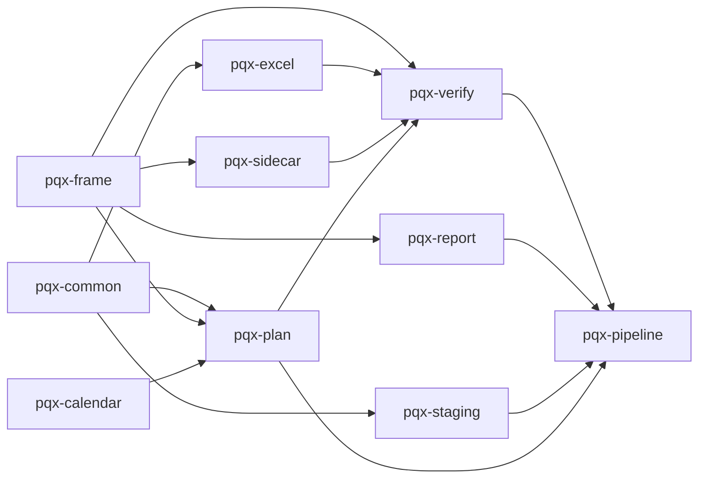

# Backlog 2: findings from the design map

Found while deriving `docs/design.md` from the code at `8ffaa6f` on 2026-10-12. None of these appears in `docs/backlog.md` or in either design audit.
No code was changed. Each fix should start with a failing test, per `CLAUDE.md`.

| # | Finding | Status | Size |
|---|---|---|---|
| 1 | `pqx-report` imports `pqx-frame` without declaring it, and declares two packages it never imports | Confirmed by experiment | Small |
| 2 | The layering diagram in `CLAUDE.md` does not match the imports | Confirmed | Small |
| 3 | `observe_sources` returns a positional triple of dictionaries | Confirmed | Small |
| 4 | Nothing checks that declared dependencies match imports | Confirmed (cause of 1) | Small |

Recommended order: 4, then 1 (the new test will fail on it), then 2, then 3.

---

## 1. `pqx-report` has a hidden dependency on `pqx-frame`

**Evidence.**
- `packages/pqx-report/src/pqx_report/model.py:17` imports `pqx_frame.timestamps.UtcDatetime`.
- `packages/pqx-report/pyproject.toml:8–10` declares `pqx-plan` and `pqx-verify` but not `pqx-frame`.
- Nothing under `packages/pqx-report/src/` imports `pqx_plan` or `pqx_verify`.

**Experiment.** Installed `pqx-report` into a fresh virtual environment twice:

| Declared dependencies | `import pqx_report.model` |
|---|---|
| As today (`pqx-plan`, `pqx-verify`) | Works: `pqx-frame` arrives transitively through both |
| Unused `pqx-plan` and `pqx-verify` removed | `ModuleNotFoundError: No module named 'pqx_frame'` |

**Why it matters.** The obvious cleanup, removing the two unused declarations, breaks the package. And `pqx-report` installs
`pqx-plan` and `pqx-verify` (with `pqx-excel`, `pqx-sidecar`, `pqx-calendar`, and their third-party dependencies) only to get one
timestamp type.

**Fix.** In `packages/pqx-report/pyproject.toml`, declare `pqx-frame` and remove `pqx-plan` and `pqx-verify`. Run
`uv lock` and the full verification. No `pqx-report` test imports either package (its tests import only `pqx_report`), so nothing
needs moving to the dev group.

---

## 2. The `CLAUDE.md` layering diagram does not match the code

**Evidence.** `CLAUDE.md:97–103` shows `pqx-common` feeding `pqx-frame`, `pqx-calendar`, and `pqx-report`. In the code, runtime imports
between packages (from `src/` only) are:

```text
pqx-common    (none)
pqx-frame     (none)
pqx-calendar  (none)
pqx-excel     -> common
pqx-sidecar   -> frame
pqx-staging   -> common
pqx-plan      -> common, frame, calendar
pqx-verify    -> frame, excel, plan, sidecar
pqx-report    -> frame
pqx-pipeline  -> all nine above
```

The diagram also omits `pqx-plan -> pqx-frame` and `pqx-verify -> pqx-plan`, and shows `pqx-report` fed by `pqx-common`.

**Why it matters.** `CLAUDE.md` is what every working session reads first, so changes get planned against a graph that does not exist.

**Fix.** Replace the diagram with one generated from the imports, after item 1 lands. The list above has 20 edges; ASCII art cannot
show them without crossings, so as Mermaid:



`pqx-pipeline` also imports `common`, `frame`, `calendar`, `excel`, and `sidecar` directly; those edges are left out to keep the
picture readable. Or point `CLAUDE.md` at the dependency matrix in `docs/design.md` section 6, so there is one place to keep current. The test in item 4
can then guard whichever copy stays.

---

## 3. `observe_sources` returns an unnamed triple

**Evidence.** `packages/pqx-pipeline/src/pqx_pipeline/run.py:224` returns
`tuple[dict[str, Observation], dict[str, dict[Bucket, int]], dict[str, UPath]]`, unpacked by position at `run.py:335`.

**Why it matters.** This is the boundary between ingest and planning. The three dictionaries share one key space (the source alias),
but only their position in the tuple says which is which, and nothing says they must have the same keys. Everywhere else the project
names stage results (`PlannedSheet`, `AllocatedWorkbook`, `NamedWorkbook`).

**Fix.** A frozen dataclass, for example `ObservedSources(observations, counts, sidecars)`, returned by `observe_sources` and passed on
by name. Low risk: one producer, one consumer. Optionally assert in its constructor that the three share the same keys.

---

## 4. No check keeps declared dependencies honest

**Evidence.** Item 1 survived CI because nothing compares a package's `[project] dependencies` with what its `src/` imports. `uv sync`
installs the whole workspace, so a missing declaration never shows up as an import error.

**Fix.** A test (for example `tools/check_dependencies.py`, run from pre-commit like `check_declarations`, or a pytest under
`packages/pqx-testing`) that, for every package:

1. reads the runtime `dependencies` from its `pyproject.toml`;
2. collects `pqx_*` imports from its `src/` with `ast`, including imports under `if TYPE_CHECKING:`;
3. fails when an imported workspace package is not declared, or a declared one is not imported.

Third-party packages can be added later; workspace packages are where the problem showed up. Written first, this test fails on
`pqx-report` today, which makes it the failing test for item 1.
