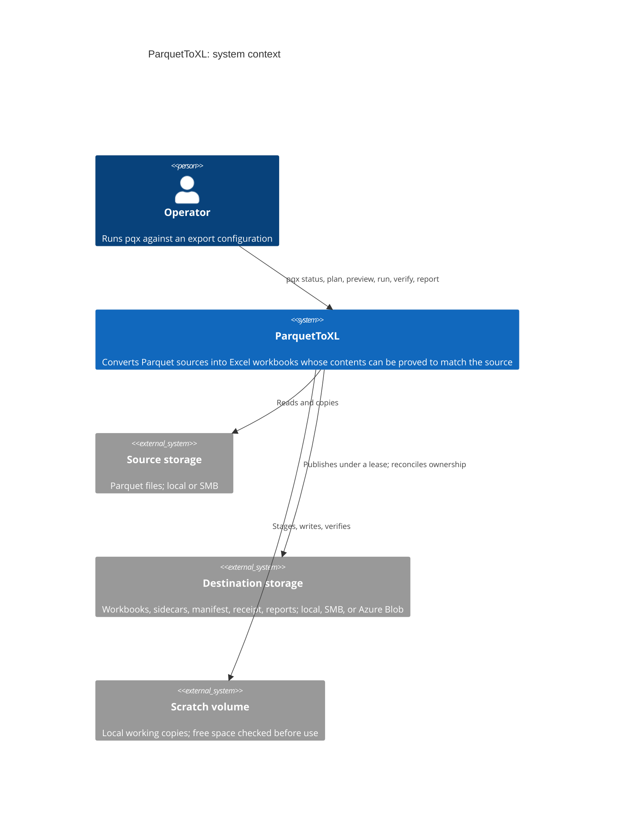
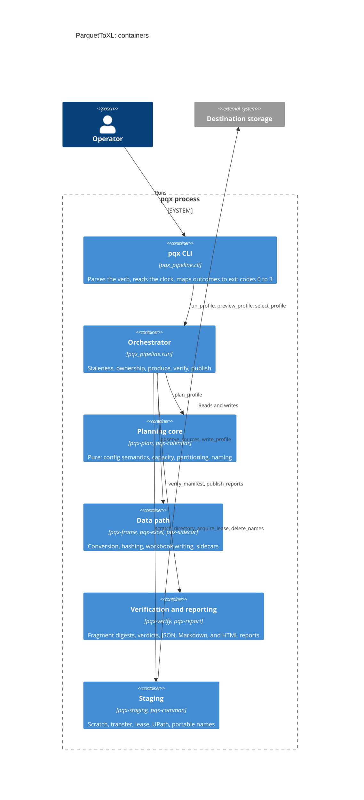
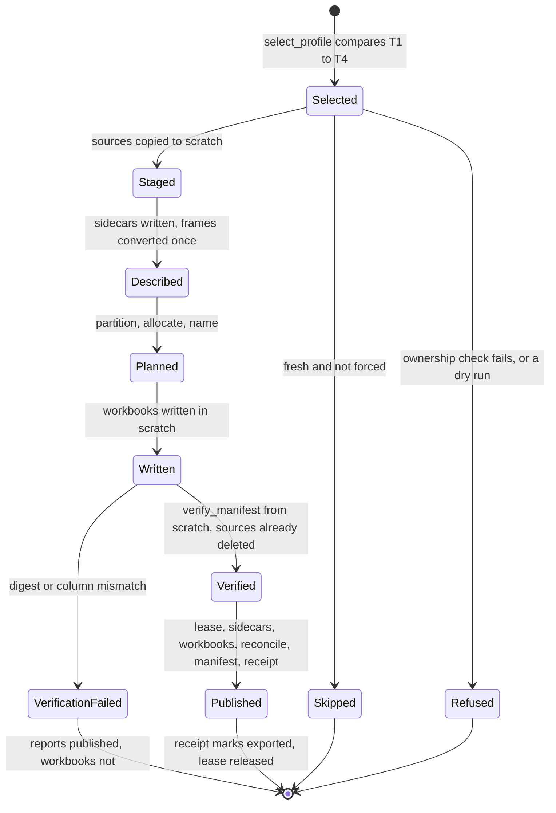
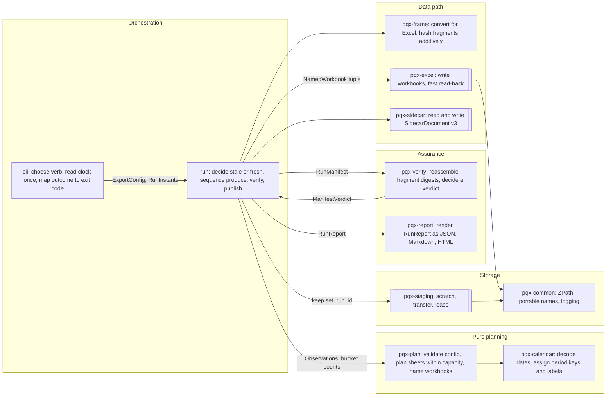

# Design: ParquetToXL

Mode: **Document**, derived from the code at `8ffaa6f` on 2026-10-12. Items marked *inferred* were deduced from the code rather than stated in a
spec; confirm or correct them. This file is a map. The authorities stay where `CLAUDE.md` says they are: `docs/export-pipeline-spec.md`,
`docs/partitioning-spec.md`, `docs/library-spec.md`, and `docs/decisions/`.

## 1. Size and numbers

- Classification: **Large**. One process (the `pqx` CLI), but three external systems: source storage, destination storage (local, SMB, or Azure Blob
  through `UPath`), and the scratch volume.
- Code: 11 uv workspace packages, 11,445 lines of library source, 985 test functions, 25,587 lines in total including tests, gates, and tools.
- Volumes, from the backlog and gate 0d: sources up to ~40M rows; a converted frame costs 7.0 to 25.4 bytes per cell depending on column mix;
  ~400M cells is the last shape that survives 16 GB of RAM, and 800M is killed for lack of memory.
- Consequence: the whole converted frame of a source is resident during writing. That peak, not the cell count, is the scaling limit
  (backlog item 3).

## 2. C4 context and containers





## 3. Domain states

One profile run, *inferred* from `run_profile` and `_publish` in `pqx_pipeline/run.py`. The two persistent markers are separate on purpose: a
sidecar means *described*, a receipt means *exported*.



Not drawn: a data refusal raised while staging, describing, or planning (`BucketingError`, `CalendarError`, `CapacityError`, and others) currently
escapes this machine entirely instead of reaching a refused or `planning-failed` state. That is backlog item 9.1.

## 4. Components



## 5. Boundary contracts

| Boundary | Input | Output | Invariants | Owner |
|---|---|---|---|---|
| Configuration | JSON file | `ExportConfig` (frozen Pydantic, `extra="forbid"`) | Agrees with `docs/export-config.schema.json`; asserted by the regenerated corpus | `pqx_plan.config`, `pqx_plan.semantics` |
| Selection | Source mtimes, sidecars, receipt | `ProfileStaleness` | T1 to T4 compared with `!=` after `truncate_to_second` | `pqx_pipeline.staleness` |
| Description | Staged Parquet | `Observation`, bucket counts, `SidecarDocument` v3 | Each source converted once; fragment digests sum mod 2^128 to the source digest | `pqx_pipeline.ingest`, `pqx-frame`, `pqx-sidecar` |
| Planning | Observations, counts, `ProfileSettings` | `tuple[NamedWorkbook, ...]` | Partition total and disjoint; within `max_data_rows_per_worksheet` and `max_cells_per_workbook`; portable names | `pqx-plan` |
| Writing | Named plan, frames | Workbooks in scratch | Local paths only (writers open filenames) | `pqx-excel` |
| Verification | Scratch, `RunManifest`, schemas | `ManifestVerdict` | Runs from scratch after sources are deleted; `VerdictKind` is a closed `Literal` | `pqx-verify` |
| Publication | Verified workbooks | Destination files, `RunManifest`, `RunReceipt` | Ownership proven by receipt; under the lease; `delete_names` takes single path segments only; receipt written last | `pqx_pipeline.run._publish`, `pqx-staging` |
| Reporting | Outcome | `RunReport` | `Outcome` is `published`, `verification-failed`, `planning-failed`, or `write-failed` | `pqx-report` |

## 6. Dependency matrix

Runtime imports between packages, from `src/` only. Rows import columns. `Y` = imported and declared, `!` = imported but not declared,
`d` = declared but not imported.

| imports ↓ / of → | common | frame | calendar | excel | sidecar | plan | verify | report | staging |
|---|---|---|---|---|---|---|---|---|---|
| frame | | | | | | | | | |
| calendar | | | | | | | | | |
| common | | | | | | | | | |
| excel | Y | | | | | | | | |
| sidecar | | Y | | | | | | | |
| staging | Y | | | | | | | | |
| plan | Y | Y | Y | | | | | | |
| verify | | Y | | Y | Y | Y | | | |
| report | | **!** | | | | **d** | **d** | | |
| pipeline | Y | Y | Y | Y | Y | Y | Y | Y | Y |

No package imports `pqx-pipeline`, and no cycles exist. Direction is inward: the pure core (`plan`, `calendar`) imports no I/O package.

## 7. Model lineage

Not applicable: the project has no SQL models. Data flows through Polars frames in memory, eagerly, by decision
(`docs/decisions/2026-09-16-lazy-frames.md`).

## 8. Directory tree

```text
ParquetToXL/
  packages/pqx-*/            11 workspace packages: src/pqx_*/ and tests/
  docs/                      specifications, decisions, backlog, audits, this file
  e2e/                       end-to-end configs, destinations, RESULTS.json
  gates/                     phase-0 measurement gates (memory, sort)
  tools/                     check_declarations.py, build_config_corpus.py
  stubs/                     workspace-wide type stubs
  .github/workflows/ci.yml   sync, pre-commit, pytest at 100% coverage
```

## 9. Decisions

The project records decisions in `docs/decisions/`, batched by phase rather than one per decision. Mapped here rather than duplicated:

| Record | Covers |
|---|---|
| `2026-09-14-phase-a.md` | Decisions taken without asking, phase A |
| `2026-09-15-phase-0.md` | Phase 0 gates, including the 150M-cell ceiling proposal |
| `2026-09-15-phase-b.md` | `pqx-calendar`, the century-window rule |
| `2026-09-15-phases-n-d-c.md` | Names, the planner, the writer |
| `2026-09-15-phases-f-g-staging.md` | Verification, reporting, file movement |
| `2026-09-15-phases-e-h.md` | Pipeline, orchestrator, command line |
| `2026-09-15-distinct-value-bucketing.md` | Bucketing by distinct values; converting each source once |
| `2026-09-16-lazy-frames.md` | Why the pipeline stays eager |

## 10. NFRs

Only requirements the repository verifies today.

| ID | Requirement | Target | Verified by |
|---|---|---|---|
| NFR-01 | Every statement and branch is tested | 100% statement and branch coverage | `pytest --cov-branch --cov-fail-under=100` in CI |
| NFR-02 | Every variable is annotated before first binding | Zero violations | `tools/check_declarations.py` in pre-commit |
| NFR-03 | Strict typing under two checkers | Zero errors | pyright and mypy in pre-commit |
| NFR-04 | Lockfile matches every package | `uv sync --locked` succeeds | CI step 1 |
| NFR-05 | Configuration models agree with the JSON Schema | Corpus validates | `docs/export-config-corpus.json`, regenerated by `tools/build_config_corpus.py` |
| NFR-06 | Exported data reassembles to the source digest | Sum of fragment digests equals source digest | `test_row_partition_additivity.py`, `verify_manifest` on every run |
| NFR-07 | Representative profiles export end to end | 8 of 9 cases publish; `null_dates_refused` refuses | `e2e/RESULTS.json` (the refusal escapes as an exception, item 9.1) |

## 11. Findings

Deviations from the design rules. Items 1 to 3 are new. Items 4 to 6 are already recorded and are listed for completeness, not as new work.
No code was changed.

1. **Rule 14, documentation drift (new).** The layering diagram in `CLAUDE.md` does not match the imports. It shows `pqx-common` feeding
   `pqx-frame`, `pqx-calendar`, and `pqx-report`, but none of the three imports `pqx-common`; `pqx-frame` and `pqx-calendar` import no internal
   package at all. Consequence: a reader plans changes against a dependency graph that does not exist. Fix: replace the diagram with section 6,
   or regenerate it from the imports.
2. **Rule 6, undeclared dependency (new).** `pqx-report` imports `pqx_frame.timestamps.UtcDatetime` without declaring `pqx-frame`, and declares
   `pqx-plan` and `pqx-verify` without importing either. It installs today only because `pqx-frame` arrives transitively through the two unused
   declarations. Consequence: removing the unused declarations breaks the package. Fix: declare `pqx-frame` and drop the other two, or confirm
   they are intended. A test that compares declared dependencies with imports would keep this true.
3. **Rule 4, untyped boundary (new, minor).** `observe_sources` returns
   `tuple[dict[str, Observation], dict[str, dict[Bucket, int]], dict[str, UPath]]`, a positional triple of dictionaries across the
   ingest-to-planning boundary. A frozen dataclass naming the three parts would match the rest of the codebase (`PlannedSheet`, `NamedWorkbook`).
4. **Rule 5, error boundary (known).** Data refusals escape the per-profile catch: backlog item 9.1, both audits.
5. **Rule 3, orchestration mixed with I/O and parameter threading (known).** `_publish` writes the manifest and receipt JSON itself, and the
   same bundle of seven arguments is threaded through six functions: `claude-design-evaluation-ParquetToXL.md` finding on parameter bundles;
   `design-evaluation-2026-10-08.md` criterion C.
6. **Rule 2, injected clock captured too early (known).** `RunInstants.at` collapses four instants into one, so the lease TTL cannot fire:
   backlog item 9.2.

Not deviations: the project uses Polars rather than DuckDB and has no SQL models (rules 7 and 8 do not apply); decision records are batched
by phase rather than one per decision, which works but makes superseding a single decision harder.

## Open questions

1. What production volumes and column mixes should the scaling limit be judged against? Backlog item 3 shows a cell ceiling misjudges
   text-heavy sources.
2. Should section 6 replace the layering diagram in `CLAUDE.md`, so there is one source of truth for package dependencies?
3. Should a test enforce that each package's declared dependencies match its imports?
